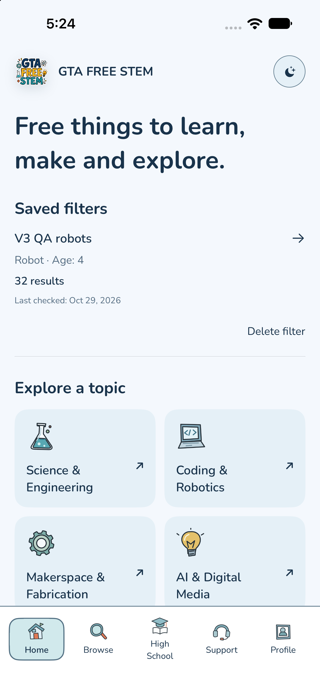
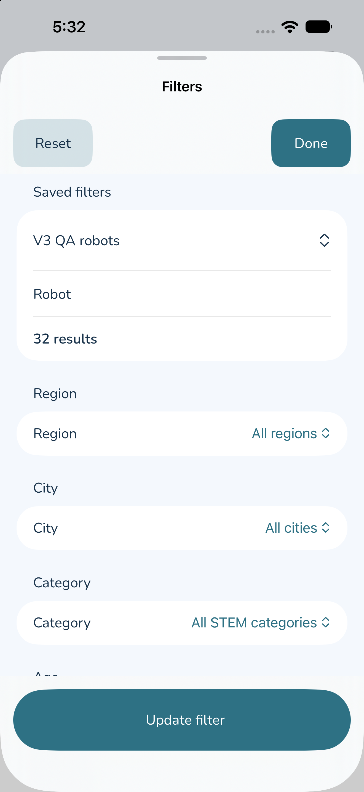

# GTA FREE STEM for iOS

I'm building GTA FREE STEM to make free STEM programs easier to find across the Greater Toronto Area. This is the native SwiftUI app for iPhone, with iPad, Mac Catalyst, and an Apple Watch companion in the project.

[Android app](https://github.com/rupayon123/gta-free-stem-android) | [Web app](https://github.com/rupayon123/gta-free-stem-opportunities) | [Try the website](https://gta-free-stem.pages.dev/)

> Owner-only **1.0 (18) is available in TestFlight** with the approved Nunito design, illustrated navigation and live saved filters. Apple reports the owner installed build 18; directly observed phone-use acceptance remains separate.

## Home, Browse and saved filters

<table>
<tr><th width="50%">A landing page for every age</th><th width="50%">Choose a named filter</th></tr>
<tr><td align="center"></td><td align="center"></td></tr>
</table>

Home introduces topics and saved filters. **Browse** keeps the search, list/map views and one clearly labeled **Filters** button. Inside Filters, choose a named preset to apply its query, age and location settings immediately and see matching results. **Save filter** creates a preset; **Update filter** explicitly saves edits. Choosing or adjusting a filter does not silently overwrite it or send Browse back Home.

Use independent filters for different ages and interests. Data stays on the device; saving a filter does not automatically enable notifications. The original logo and animated loading experience remain intact. Navigation now reserves its own opaque space so page content cannot obscure the labels, including in dark mode and at large text sizes.

These are actual simulator captures from production source `a96d2f4246e574c65a1200503393c54291a824bd`, not physical-device or App Store screenshots. [Capture provenance](docs/showcase/2026-10-29/capture-receipt.json) · [Browse preview](docs/showcase/2026-10-29/browse-light.png).

<details>
<summary>Previous build 15: October 27 screenshots</summary>

<table>
<tr><th width="50%">Home</th><th width="50%">Native map</th></tr>
<tr><td align="center"><a href="docs/showcase/2026-10-27/normal-home.jpg"></a></td><td align="center"><a href="docs/showcase/2026-10-27/ios-map-overview-light.jpg"></a></td></tr>
</table>

Captured from source `08c172d20060ec0748fccae2677c7554c3fe8145` in the [October 27 simulator CI run](https://github.com/rupayon123/gta-free-stem-ios/actions/runs/40521124677). These are normal-runtime captures using the public feed, not sample layout fixtures: Home shows 1,877 available results at capture time; the map shows 94 physical venues containing 1,832 opportunities. [Capture provenance and image hashes](docs/showcase/2026-10-27/capture-receipt.json). These resized JPEG exports are repository previews, not physical-device acceptance or the final App Store screenshot package.


</details>

<details>
<summary>Historical build 12 screenshots, captured September 11</summary>

<table>
<tr><th width="50%">Home</th><th width="50%">Search</th></tr>
<tr><td align="center"><a href="docs/showcase/home.png"></a></td><td align="center"><a href="docs/showcase/search.png"></a></td></tr>
<tr><th>High School Search</th><th>Profile</th></tr>
<tr><td align="center"><a href="docs/showcase/hs-search.png"></a></td><td align="center"><a href="docs/showcase/profile.png"></a></td></tr>
</table>

The source revision of that installed build was not established. [Historical capture notes](docs/showcase/README.md).
</details>

## About the app

Search by location, age and category in your chosen interface language, or use the High School section for volunteer hours, co-op, and mentorship. Open a program's source page, get directions with Apple Maps, and keep a shortlist on your device.

There's no account to create. Your profile, saved opportunities, searches, and settings stay on-device. Nearby search requests your location only when you ask for it. The app has no ads, purchases, or third-party analytics.

The app reads the public opportunity feed from the web repository and keeps a local cache for offline browsing. The feed pipeline handles source collection and updates; the native app doesn't crawl provider websites.

## Development status

The previous owner update **1.0 (17)** introduced the startup crash fix, which is preserved in build 18. That update passed 193 local core tests, 52 archive checks and 62 uploaded-app checks. Its delivery evidence remains historical; build 18 is the current owner update.

**Owner build 18 is available in TestFlight.** The approved Nunito design and original illustration assets are integrated. Actual simulator checks cover padded Reset/Done with Show Borders enabled, live named-filter selection, explicit updates, normal/maximum text, Arabic, dark mode and five-route navigation. All 193 tests passed on the final diagnostic run. The archive passed 52 strict checks, and the exact uploaded app passed 62 distribution checks. Apple confirms Testing for the existing sole-owner group.

Public App Store distribution remains incomplete. Full catalogue adoption, qualified full-description translations and physical-device acceptance are separate work; external tester sharing remains on hold. [Build 18 status](docs/OWNER_BUILD18_STATUS.md) · [Portfolio implementation and retained findings](docs/PORTFOLIO_V3_IOS.md).

[Historical release handoff](docs/CURRENT_RELEASE_HANDOFF.md) | [Release runbook](docs/PUBLIC_RELEASE_RUNBOOK.md) | [TestFlight setup](docs/TESTFLIGHT.md) | [Device signoff](docs/TESTFLIGHT_REAL_DEVICE_SIGNOFF.md)

## Run locally

Open `GTAFreeSTEM.xcodeproj` in Xcode, select the `GTAFreeSTEM` scheme, and run it on an iOS 17 or newer simulator or device. The tracked project opens directly; XcodeGen is optional.

To build and run tests, replace the destination with a simulator installed on your Mac:

```bash
xcodebuild build -project GTAFreeSTEM.xcodeproj -scheme GTAFreeSTEM -destination 'platform=iOS Simulator,name=iPhone 17'
xcodebuild test -project GTAFreeSTEM.xcodeproj -scheme GTAFreeSTEM -destination 'platform=iOS Simulator,name=iPhone 17'
```

## Project layout

- `GTAFreeSTEM/`: iPhone, iPad, and Mac Catalyst app.
- `GTAFreeSTEMWatch/`: Apple Watch companion.
- `GTAFreeSTEMTests/`: tests.
- `docs/`: setup, privacy, and release notes.

## Contributing

Help with accessibility, translations, device testing, and bug fixes is welcome.

- [Contributing](CONTRIBUTING.md)
- [Localization](docs/LOCALIZATION.md)
- [Code of conduct](CODE_OF_CONDUCT.md)
- [Security](SECURITY.md)

## License

[MIT](LICENSE) for the app's source and documentation. Program descriptions and third-party names and materials belong to their respective owners.
