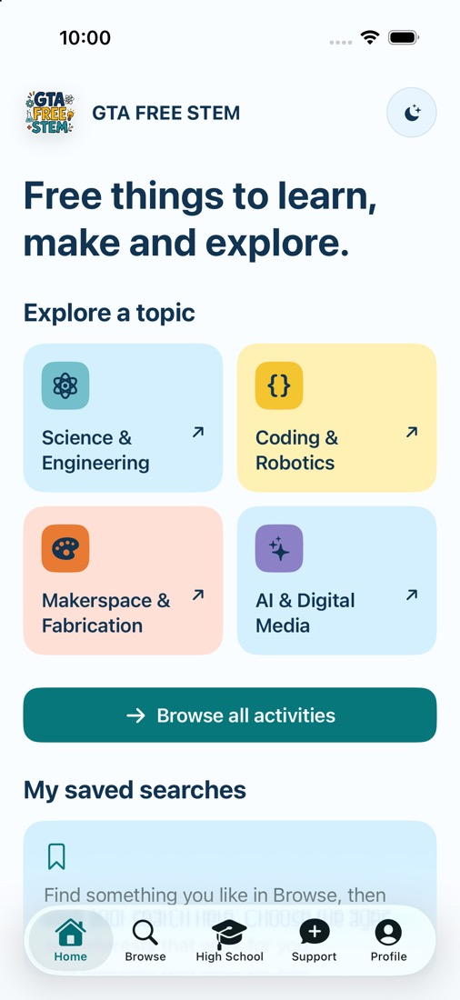
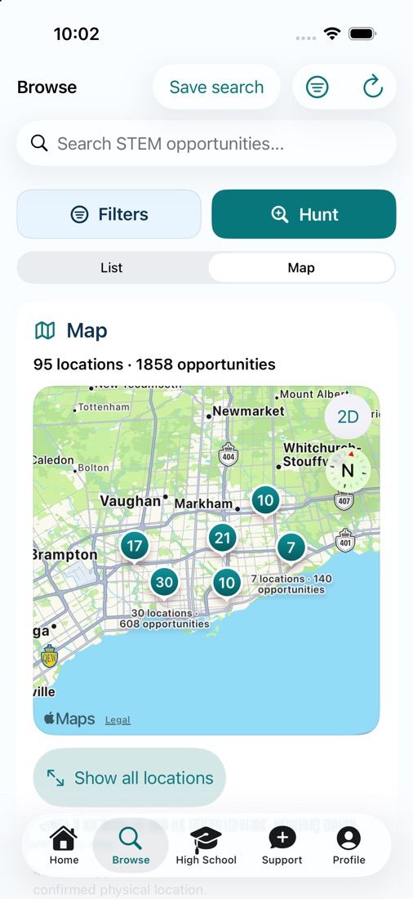
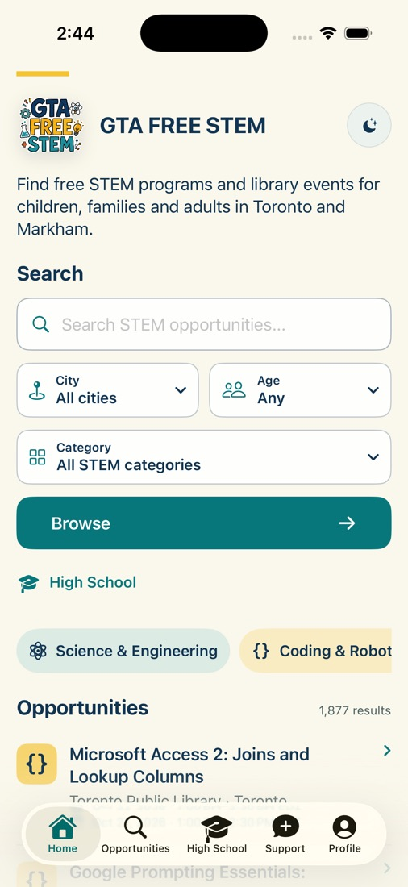
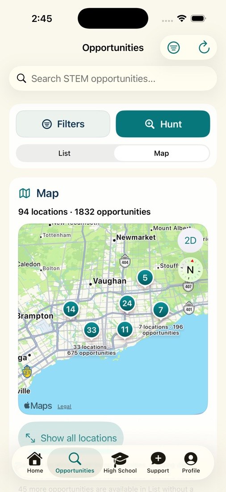
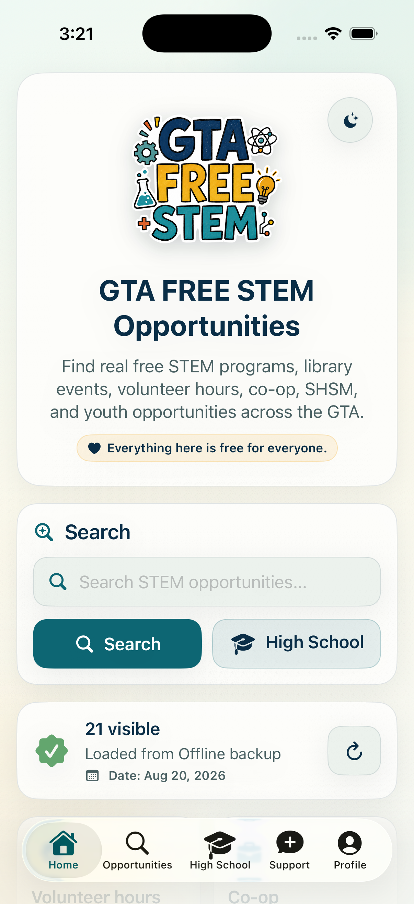
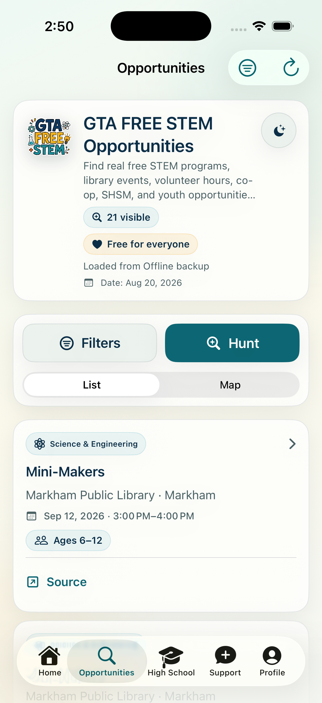
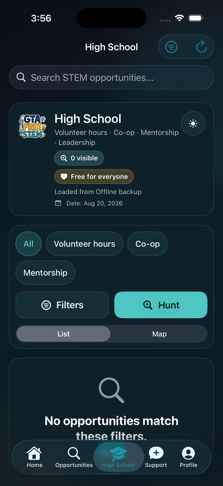
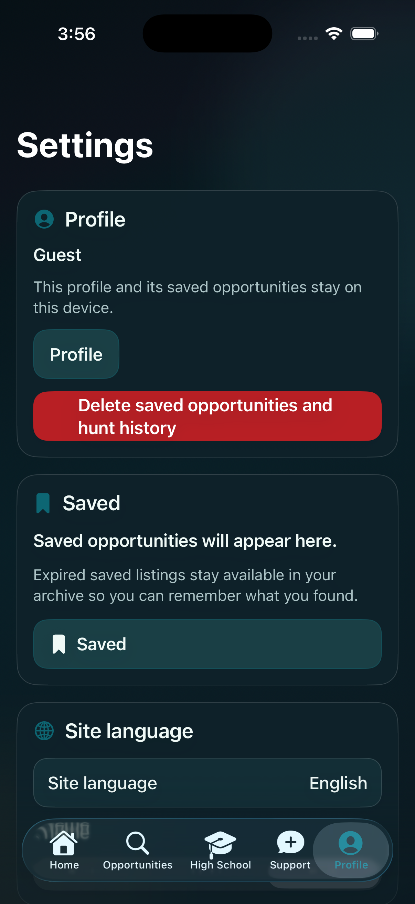

# GTA FREE STEM for iOS

I'm building GTA FREE STEM to make free STEM programs easier to find across the Greater Toronto Area. This is the native SwiftUI app for iPhone, with iPad, Mac Catalyst, and an Apple Watch companion in the project.

[Android app](https://github.com/rupayon123/gta-free-stem-android) | [Web app](https://github.com/rupayon123/gta-free-stem-opportunities) | [Try the website](https://gta-free-stem.pages.dev/)

> Owner-only development update **1.0 (16) is uploaded and processing**. The new Home introduces topics and independently saved searches; Browse keeps the search tools. See the [candidate status](docs/DEVELOPMENT_CANDIDATE.md).

## New Home in development

<table>
<tr><th width="50%">Topic-led Home</th><th width="50%">Native map</th></tr>
<tr><td align="center"><a href="docs/showcase/2026-10-28/normal-home.jpg"></a></td><td align="center"><a href="docs/showcase/2026-10-28/ios-map-overview-light.jpg"></a></td></tr>
</table>

Actual simulator captures from source `692bdcd81e6bd091d920b35698b30fb4658f2dd7`, using the public feed. Home offers topic choices and a clear Browse entry. Save separate named searches in Browse for different ages or interests, then return Home for matching-event updates. These local searches need no account and do not automatically enable notifications. [Capture provenance and hashes](docs/showcase/2026-10-28/capture-receipt.json). These are source-bound simulator previews of the new Home, not phone acceptance or final App Store screenshots.

<details>
<summary>Previous build 15: October 27 screenshots</summary>

<table>
<tr><th width="50%">Home</th><th width="50%">Native map</th></tr>
<tr><td align="center"><a href="docs/showcase/2026-10-27/normal-home.jpg"></a></td><td align="center"><a href="docs/showcase/2026-10-27/ios-map-overview-light.jpg"></a></td></tr>
</table>

Captured from source `08c172d20060ec0748fccae2677c7554c3fe8145` in the [October 27 simulator CI run](https://github.com/rupayon123/gta-free-stem-ios/actions/runs/40521124677). These are normal-runtime captures using the public feed, not sample layout fixtures: Home shows 1,877 available results at capture time; the map shows 94 physical venues containing 1,832 opportunities. [Capture provenance and image hashes](docs/showcase/2026-10-27/capture-receipt.json). These resized JPEG exports are repository previews, not physical-device acceptance or the final App Store screenshot package.


</details>

<details>
<summary>Historical build 12 screenshots, captured September 11</summary>

<table>
<tr><th width="50%">Home</th><th width="50%">Search</th></tr>
<tr><td align="center"><a href="docs/showcase/home.png"></a></td><td align="center"><a href="docs/showcase/search.png"></a></td></tr>
<tr><th>High School Search</th><th>Profile</th></tr>
<tr><td align="center"><a href="docs/showcase/hs-search.png"></a></td><td align="center"><a href="docs/showcase/profile.png"></a></td></tr>
</table>

The source revision of that installed build was not established. [Historical capture notes](docs/showcase/README.md).
</details>

## About the app

Search by location, age and category in your chosen interface language, or use the High School section for volunteer hours, co-op, and mentorship. Open a program's source page, get directions with Apple Maps, and keep a shortlist on your device.

There's no account to create. Your profile, saved opportunities, searches, and settings stay on-device. Nearby search requests your location only when you ask for it. The app has no ads, purchases, or third-party analytics.

The app reads the public opportunity feed from the web repository and keeps a local cache for offline browsing. The feed pipeline handles source collection and updates; the native app doesn't crawl provider websites.

## Development status

The latest owner-only internal iPhone upload is **1.0 (16)**, from source `1338441b5daa7d7281d0d22d6d5e7da552a88f54`. Apple shows Processing; availability and installation remain unverified. Its archive and retained uploaded IPA passed 52/52 and 62/62 strict checks. All 187 test stages passed, while the remote screenshot stage failed; 31 reviewed local native frames match the delivered UI. [Build 16 evidence and limitations](docs/DEVELOPMENT_CANDIDATE.md).

Public App Store release is **not complete**. Full catalogue/translation work, final screenshot automation, physical iPhone/iPad, paired Watch and Mac acceptance, and existing public-release gates remain separate work. External tester sharing stays on hold until the owner's visual review. [The prior build 15 record](docs/CURRENT_RELEASE_HANDOFF.md) preserves its historical upload evidence; the owner has since installed15.

[Release runbook](docs/PUBLIC_RELEASE_RUNBOOK.md) | [TestFlight setup](docs/TESTFLIGHT.md) | [Device signoff](docs/TESTFLIGHT_REAL_DEVICE_SIGNOFF.md)

## Run locally

Open `GTAFreeSTEM.xcodeproj` in Xcode, select the `GTAFreeSTEM` scheme, and run it on an iOS 17 or newer simulator or device. The tracked project opens directly; XcodeGen is optional.

To build and run tests, replace the destination with a simulator installed on your Mac:

```bash
xcodebuild build -project GTAFreeSTEM.xcodeproj -scheme GTAFreeSTEM -destination 'platform=iOS Simulator,name=iPhone 17'
xcodebuild test -project GTAFreeSTEM.xcodeproj -scheme GTAFreeSTEM -destination 'platform=iOS Simulator,name=iPhone 17'
```

## Project layout

- `GTAFreeSTEM/`: iPhone, iPad, and Mac Catalyst app.
- `GTAFreeSTEMWatch/`: Apple Watch companion.
- `GTAFreeSTEMTests/`: tests.
- `docs/`: setup, privacy, and release notes.

## Contributing

Help with accessibility, translations, device testing, and bug fixes is welcome.

- [Contributing](CONTRIBUTING.md)
- [Localization](docs/LOCALIZATION.md)
- [Code of conduct](CODE_OF_CONDUCT.md)
- [Security](SECURITY.md)

## License

[MIT](LICENSE) for the app's source and documentation. Program descriptions and third-party names and materials belong to their respective owners.
